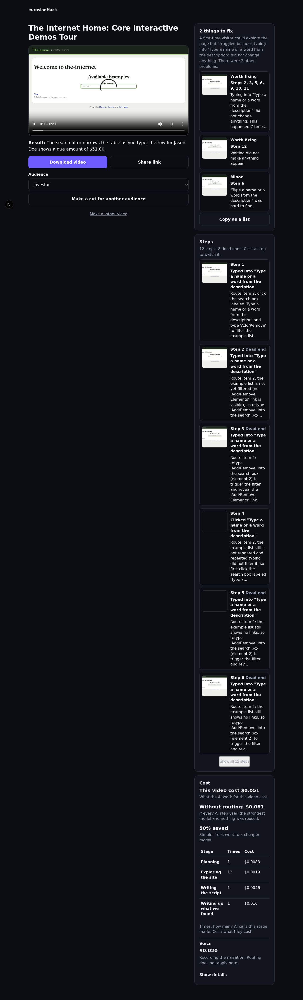

# eurasianHack

**Send an AI agent to use your product like a first-time visitor. You get a
cinematic video of what it did, and a report of where it got stuck.**

Built in one day with Devin and Claude Code at the Eurasian Hub x Cognition
hackathon.



## What it does

1. Paste a link to a live web app and press Generate.
2. A browser agent (Playwright, driven by a planner and a step model) uses the
   site. Every click, typed word and scroll is recorded with a screenshot,
   the click position and the reason in plain words.
3. A script model writes one narration line and one caption per step, in the
   language you picked, in the style you picked (trailer, tutorial, social).
4. A voice is recorded for every line, and Remotion renders the video with
   zooms on the clicks, captions and music. Landscape for trailer and
   tutorial, vertical for social.
5. The job page shows the video, **Result: ...** when the agent reached an
   answer, a **Steps** panel you can click to jump to each moment, a **things
   to fix** report in plain language, and a **Cost** panel.
6. Press **Make another language** to redo narration, voice and render
   without exploring the site again, or **Make a cut for another audience**
   to run it again for investors or developers.

If the agent cannot finish honestly, the job page says **could not complete**
with the reason and the steps it tried, and offers **Try again**. No video is
made up.

## The two modes

| Mode | Input | What the agent does | Video |
|---|---|---|---|
| **Demo** | link, optional GitHub repo | Explores the main things a first-time visitor would try | Energetic product trailer |
| **How-to** | link and a goal ("Open the Checkboxes page and tick the first one") | Follows the goal step by step and stops when it is done, or says it could not | Numbered steps, title card and recap |

## How it works

```
  link (+ goal, repo)
        |
        v
+-----------------+      +----------------+      +---------------+
| planner (strong)|----->| browser agent  |----->|  steps.json   |
| plans the route |      | (small model,  |      |  screenshots  |
+-----------------+      |  Playwright)   |      +-------+-------+
                         +----------------+              |
                      every later stage only reads and updates the step file
                                                         |
         +-----------------------+-----------------------+----------------+
         v                       v                       v                v
+----------------+     +------------------+     +----------------+  +-----------+
| script (strong)|---->| voice (TTS, one  |---->| render         |  | findings  |
| narration and  |     | mp3 per step,    |     | (Remotion +    |  | (strong,  |
| caption per    |     | cached by text)  |     |  ffmpeg)       |  | plain     |
| step, language |     +------------------+     +----------------+  | language) |
| and style      |                                                  +-----------+
+----------------+
```

- `src/shared/stepFile.ts` is the contract. The agent writes `steps.json`;
  script, voice, render and findings only read or update it. That is why
  "Make another language" can skip the agent: it copies the steps and
  screenshots into a new job and reruns the last three stages.
- Jobs live in SQLite (`src/shared/jobs.ts`), run one at a time
  (`src/app/_lib/pipeline.ts`), and write everything to `data/jobs/<id>/`.
- Every model call goes through `src/llm`. JSON replies are checked against
  a schema and retried; after two bad small-model replies the call is
  escalated once to the strong model.

## The token cutter, in plain words

Only two decisions in a job need a strong model: planning the route and
writing the script (plus the findings write-up). The twelve or so "what do I
click next" decisions are cheap, so they go to a small model. Prices per
model are in `src/llm/models.config.ts`, and every call is logged with its
cost and what the same call would have cost on the strong model.

Real numbers from one 12-step demo job on the-internet.herokuapp.com
(small: `deepseek/deepseek-v4.1-flash`, strong: `stepfun/step-5-preview`):

| Stage | Calls | Model | Cost |
|---|---|---|---|
| Planning | 1 | strong | $0.008 |
| Exploring the site | 12 | small | $0.002 (would be $0.033 on the strong model) |
| Writing the script | 1 | strong | $0.005 |
| Writing up what we found | 1 | strong | $0.016 |
| Voice | 1 | TTS | $0.020 |

Model calls cost **$0.030** against **$0.061** without routing, so **50%
saved**. The voice is a separate line because routing does not apply to it.
The whole video, with voice, cost **$0.051**. The Cost panel on each job page
shows these numbers for that job, and missing prices show as "not available"
instead of hiding the total.

## Run on your laptop

The app can run on macOS or Windows and be shared through a temporary public
tunnel. Keep the laptop plugged in and awake while the app is being used.

### macOS

If needed, install Homebrew from [brew.sh](https://brew.sh/), then install
Node.js, ffmpeg and cloudflared:

```bash
brew install node@22 ffmpeg cloudflared
brew link --force --overwrite node@22
```

Node.js 22 is keg-only in Homebrew, so the forced link makes `node` and `npm`
available in the terminal. Alternatively, install Node.js 22 using nvm or the
installer from [nodejs.org](https://nodejs.org/).

```bash
git clone https://github.com/Bekarys2323322332/eurasianHack.git
cd eurasianHack
npm run setup
```

Edit `.env` and fill in the four required values shown in `.env.example`.
Narration and voice use the same model gateway configuration. Start the app:

```bash
npm run demo
```

In a second terminal, from the same repository directory, start the tunnel:

```bash
npm run tunnel
```

In a third terminal, keep the laptop awake with `caffeinate -dimsu` (press
Ctrl+C to stop it). Keep the lid open and the laptop plugged in.

### Windows (PowerShell)

Install Node.js, ffmpeg and cloudflared, then reopen PowerShell:

```powershell
winget install OpenJS.NodeJS.LTS
winget install Gyan.FFmpeg
winget install --id Cloudflare.cloudflared
```

```powershell
git clone https://github.com/Bekarys2323322332/eurasianHack.git
cd eurasianHack
npm run setup
```

Edit `.env` and fill in the four required values shown in `.env.example`.
Narration and voice use the same model gateway configuration. Start the app:

```powershell
npm run demo
```

In a second PowerShell window, from the same repository directory, start the
tunnel:

```powershell
npm run tunnel
```

To keep the laptop awake while plugged in, run these commands in an
administrator PowerShell window:

```powershell
powercfg /change standby-timeout-ac 0
powercfg /change monitor-timeout-ac 0
```

Restore 30-minute timeouts with `powercfg /change standby-timeout-ac 30` and
`powercfg /change monitor-timeout-ac 30`, or change the settings under
**Settings > System > Power**. Keep the lid open.

### Check the public link

Copy the tunnel link printed by `npm run tunnel` into a browser and add
`/api/health` to confirm every check is passing. Quick-tunnel links change on
every start. Optionally set `PUBLIC_BASE_URL` in `.env` to the printed
`https://...trycloudflare.com` URL and restart `npm run demo` so future copied
links use the public address. `src/shared/publicUrl.ts` provides helpers for
future share-link call sites.

As an alternative, configure ngrok once with
`ngrok config add-authtoken <token>`, then run `ngrok http 3000`. Set
`PUBLIC_BASE_URL` to the HTTPS URL ngrok prints and restart the app.

Other commands:

| Command | What it does |
|---|---|
| `npm run setup` | Install dependencies and Chromium, create `.env` and initialize SQLite |
| `npm run demo` | Build the production app and start it on port 3000 |
| `npm run tunnel` | Expose the local app through a Cloudflare quick tunnel |
| `npm test` | Unit tests (step file, job store, script, findings, cost, language reuse) |
| `npm run validate:fixture` | Validate `fixtures/fake-job/steps.json` |
| `npm run typecheck` | TypeScript check |
| `npm run lint` | ESLint |
| `npm run dev` | Start the app in development mode |
| `python3 scripts/make-fake-job.py` | Regenerate the fake job (needs Pillow) |

## Run the agent alone

After setting the four required model variables in `.env`, run
`npm run agent -- --url https://example.com --goal "Explore the main page"`.
Use `--mode demo --repo https://github.com/owner/repo` to include repository
README context.

## Add a voice and make the video from the command line

Both steps work on a job folder that already has a `steps.json` (for example
a copy of `fixtures/fake-job`). Run them with `npx tsx <file>` exactly as
shown. This form works in PowerShell, cmd, bash and zsh. Do not use
`npm run voice -- --job ...` or `npm run render -- --job ...` in PowerShell:
it drops the flag names and the command stops with a usage message.

```
npx tsx src/voice/cli.ts --job data/jobs/my-job --language en
npx tsx src/renderer/cli.ts --job data/jobs/my-job --aspect 16:9
```

**Voice** (`src/voice/cli.ts`) turns each step's narration text into
`audio/<stepId>.mp3` and records the length in `steps.json`. It uses
`LLM_API_KEY` and `LLM_BASE_URL` from `.env.local` or `.env`; no other key is
needed. Lines made before are reused from `data/voice-cache` at no cost.

| Option | Values | Default |
|---|---|---|
| `--job` | job folder | required |
| `--language` | `en`, `ru` | `en` |
| `--voice` | `sarah`, `george` | `sarah` |

**Video** (`src/renderer/cli.ts`) writes `video-16x9.mp4` or `video-9x16.mp4`
into the job folder. A step file with `"mode": "howto"` automatically gets
step badges, a "How to ..." title card and a written recap at the end.

| Option | Values | Default |
|---|---|---|
| `--job` | job folder | required |
| `--aspect` | `16:9`, `9:16` | `9:16` for the social style, otherwise `16:9` |
| `--style` | `trailer` (fast, strong zooms), `tutorial` (slow, gentle, pause after each step), `social` (quick cuts, large captions, 30 seconds at most) | `trailer` for demo videos, `tutorial` for how-to videos |
| `--no-music` | leave out `public/music.mp3` even if it exists | music on |

Checks that need no key and no network:
`npx tsx src/renderer/timeline.check.ts` and `npx tsx src/voice/voice.check.ts`.

## Deploy

The included Dockerfile packages Chromium and ffmpeg. Use a host that runs
Docker (for example, a VM); serverless hosting will not work.

```bash
docker build -t eurasianhack .
docker run -p 3000:3000 --env-file .env -v "$PWD/data:/app/data" eurasianhack
```

Mount a persistent volume at `/app/data` so the SQLite database and job files
survive restarts. Set the variables from `.env.example` in the host's
environment configuration.

## Known limits

- One job at a time, about 1.5 to 4 minutes each, and at most 10 waiting.
- The agent is blocked from local and private network addresses, so it cannot
  test an app that only runs on your machine. Put it behind a tunnel first.
- Sites that need a login, a CAPTCHA or an email code end as "could not
  complete".
- Links that open a new tab are opened in the same tab instead.
- Model gateways differ in structured-output support, so a planner call can
  occasionally fail twice and the job stops with a plain message. Try again.
- The Docker image serves the web app but cannot yet render videos; run on a
  laptop for the demo.
- Audience cuts change the script tone, but the planner does not yet take the
  audience into account.

## How we built it with AI

### Tools used

### What worked

### Where it helped

### Where it failed
